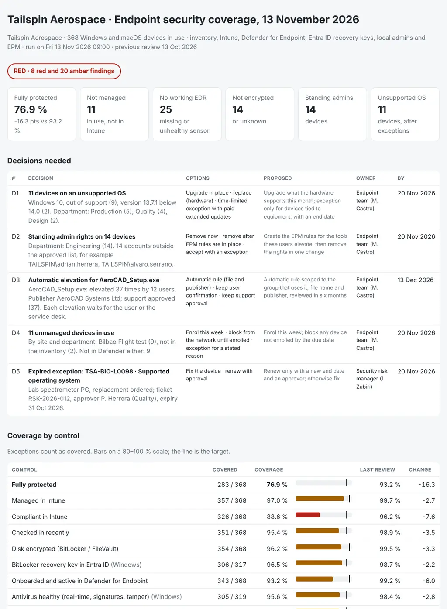

# Endpoint Security Coverage

The question for the endpoint team and security every month: is every laptop and desktop we have actually protected? Managed in Intune, encrypted with its recovery key where the service desk can find it, reporting to Defender for Endpoint, without standing local admin rights, and on a supported operating system. And if not, which devices, why, and what do we fix first? From the asset inventory, the Intune devices, the Defender device inventory, the BitLocker recovery keys in Entra ID, the local administrators, the Endpoint Privilege Management elevations and the exceptions register, it puts together:

- **One list from three sources:** every device in the inventory, Intune and Defender matched by serial number, name and Entra device ID, with what each tool is missing: devices in use that no tool manages, devices the inventory does not have, and retired devices that still check in.
- **Coverage by control:** managed, compliant, checking in, encrypted, recovery key escrowed, EDR onboarded and healthy, antivirus healthy (real-time protection, signatures, tamper protection), no standing local admins, supported OS; per device, site, department and platform, against a target per control and last month.
- **Privilege:** standing members of the local Administrators group, the files that many users elevate with approval (candidates for an automatic EPM rule) and unsigned files elevated.
- **Exceptions:** valid ones count as covered; expired, expiring and incomplete ones (no approver, ticket or expiry) come back as findings.

Every gap has an owner and a due date, the gaps that need a choice (an unsupported OS, standing admin rights, an automatic elevation rule, devices nobody enrolled, an expired exception) become **decisions**, and the pack carries the evidence an ISO 27001 or NIS2 auditor asks for: **which devices are not protected, by which control, why, and what we fix first.**

Python 3.10+, standard library only. It runs with fictional demo data out of the box. A read-only PowerShell collector reads Intune and the recovery key metadata through Microsoft Graph, and an Intune Remediations detection script reports the local administrators.

The review sits next to two earlier repos in the series: [02-intune-compliance-report](https://github.com/inigogonzalezgarcia/02-intune-compliance-report) reports Intune compliance by policy and setting, and [51-windows-server-baseline-drift](https://github.com/inigogonzalezgarcia/51-windows-server-baseline-drift) does for the Windows servers what this review does for the endpoints.



## Why

Each tool shows its own view, and each view looks fine on its own. In a typical month with four hundred devices:

- the field team builds nine flight test laptops locally to save time, and they never reach Intune or Defender;
- six new engineering workstations are enrolled, but their group is not in the Defender onboarding policy;
- a firmware update suspends BitLocker on two laptops and nobody resumes it;
- eleven laptops imaged by the old process are encrypted, but their recovery key is not in Entra ID, so the service desk cannot unlock them;
- an application vendor asks to "turn off the antivirus" on two CAD workstations, and it stays off;
- a CAD rollout adds fourteen engineers to the local Administrators group "for a week";
- the service desk approves the same installer thirty-seven times in a month;
- a lab tool with no publisher is elevated on the flight test bench;
- Windows 10 lingers on the production floor after its end of support, with one exception that expired last month;
- two retired laptops still check in, and five devices in use are not in the inventory at all.

Intune shows compliance, Defender shows sensor health, the CMDB shows what was bought, and nobody reads them together. The review does, and turns the result into a short list of fixes and decisions. The rules are in `settings.json` and `endpointcoverage/checks.py`.

## What it checks

| Area | Code | Finding | Severity |
|---|---|---|---|
| Inventory | INV-UNMANAGED | In use in the inventory, not enrolled in Intune | RED |
| Inventory | INV-UNKNOWN, INV-RETIRED | In Intune or Defender but not in the inventory; retired but still active | AMBER |
| Defender | EDR-MISSING | Managed in Intune, not onboarded to Defender for Endpoint | RED |
| Defender | EDR-UNHEALTHY | Onboarded, but inactive, impaired, with no sensor data or no report for 7 days | AMBER |
| Encryption | ENC-OFF | BitLocker or FileVault off | RED |
| Encryption | ENC-NOKEY | Encrypted Windows device with no operating system volume key in Entra ID | AMBER |
| Antivirus | AV-REALTIME | Real-time protection off | RED |
| Antivirus | AV-SIGNATURES, AV-TAMPER | Signatures overdue; tamper protection off | AMBER |
| Intune | MDM-NONCOMPLIANT, MDM-CHECKIN | Not compliant; no check-in for 14 days | AMBER |
| Privilege | PRIV-ADMIN | Local administrators outside the approved list | RED |
| Privilege | EPM-RULE, EPM-UNSIGNED | A file elevated with approval by 5 or more users; an unsigned file elevated | AMBER |
| OS | OS-UNSUPPORTED | Below the minimum Windows or macOS version (Windows 10 is out of support) | RED |
| Exceptions | EXC-EXPIRED | Expired and the gap still there | RED on MDM, EDR, encryption, admin or OS; AMBER otherwise |
| Exceptions | EXC-EXPIRING, EXC-INCOMPLETE | Expiring within 30 days; no approver, ticket or expiry (it does not count) | AMBER |
| Coverage | CTL-TARGET | A control below its target (98 %, 99 % for MDM, EDR and encryption); below 90 % | AMBER, RED |

A device with no data for a control (for example, missing from the local admin report) is counted as unknown, not as covered, and the report says how many. [docs/data-format.md](docs/data-format.md) has every rule.

## Outputs

| File | What |
|---|---|
| `report.html` | Tiles (fully protected and the change since last month, not managed, no working EDR, not encrypted, standing admins, unsupported OS), the decisions, coverage per control against target and last month, a heat map of departments by control, the three sources reconciled, the EPM elevations, the exceptions and every finding |
| `review-pack.md` | One page for the monthly endpoint security review: headlines, coverage by control, decisions needed, actions with owner and date, coverage by site and department, the audit evidence summary, scope and notes |
| `device-coverage.csv` | One row per device in scope: site, department, user, platform, which tools have it, fully protected, number of gaps, risk score and the status of every control |
| `gaps.csv` | One row per device and control not covered (exceptions included), with the cause |
| `reconciliation.csv` | Every Windows and macOS device in any source: inventory status, Intune check-in, Defender health and what is missing |
| `coverage-summary.csv` | Coverage per control; next month's `previous-coverage.csv` |
| `elevations-review.csv` | Every elevated file with elevations, users, devices, types and whether it needs a review |
| `exceptions-review.csv` | Every exception with its state (valid, expiring, expired, incomplete, not needed) and the action |
| `findings.csv`, `actions.csv` | Every finding with severity, devices, owner and due date; the same as actions with a reference and a done column |

## Try it

```bash
git clone https://github.com/inigogonzalezgarcia/52-endpoint-security-coverage.git
cd 52-endpoint-security-coverage
python -m endpointcoverage demo
```

Open `output/report.html` and `output/review-pack.md`.

### The demo data

The demo is a made-up maker of drone and avionics parts, Tailspin Aerospace, with two sites, Madrid and Bilbao, and 368 laptops, workstations and Macs in use in the asset inventory, managed with Intune and protected with Defender for Endpoint. The review runs on Friday 13 November 2026; the previous one was on 13 October:

- 378 inventory records, 373 Intune devices, 358 Defender devices, 308 recovery keys, 962 local administrator memberships, 85 EPM elevations and 6 exceptions.

Everything is fictional: devices, people, tickets and values. The problems are placed on purpose among devices that are fine:

- **Not managed:** 9 flight test laptops in Bilbao built locally, in no tool.
- **Not onboarded:** 6 new engineering workstations in Intune whose group is not in the Defender onboarding policy; 10 sensors not healthy.
- **Encryption:** BitLocker suspended on 2 laptops after a firmware update, FileVault off on a Mac, and 11 production laptops with no recovery key in Entra ID.
- **Antivirus:** real-time protection off on 2 CAD workstations, signatures overdue on 7 test bench laptops, tamper protection off on 5.
- **Standing admins:** 14 engineers left in the local Administrators group after a CAD tool rollout, one of them with an exception that has no approver.
- **EPM:** the CAD installer elevated 37 times by 12 users with service desk approval; an unsigned avionics flashing tool elevated 4 times.
- **Unsupported OS:** 12 Windows 10 devices on the production floor and in the lab (3 under a valid exception, 1 whose exception expired on 31 October) and 2 Macs below macOS 14.
- **Inventory:** 5 devices in use that the inventory does not have, and 2 retired laptops still checking in.

The result: **RED**; **76.9 % of 368 devices fully protected**, down from 93.2 % at the last review; Defender coverage 93.2 % against a 99 % target; 11 devices not managed, 25 without a working EDR sensor, 3 not encrypted, 14 with standing admins and 11 on an unsupported OS after exceptions; 8 red and 20 amber findings and 5 decisions: the unsupported OS, the admin rights, an automatic rule for the CAD installer, the unmanaged devices and the expired exception.

## Use it with your own data

1. Export `inventory.csv` from the CMDB or the asset register (device, serial, platform, site, department, user, status).
2. Collect (read-only), from a workstation with the Microsoft Graph PowerShell SDK:
   ```powershell
   Copy-Item .\output\coverage-summary.csv .\data\previous-coverage.csv     # last month's coverage, for the trend
   .\scripts\Collect-EndpointCoverage.ps1 -OutputFolder .\data `
       -DefenderCsv .\downloads\defender-devices.csv -RemediationCsv .\downloads\detect-localadmins.csv
   ```
   - Intune: `Get-MgDeviceManagementManagedDevice -All` (`DeviceManagementManagedDevices.Read.All`), and for each Windows device its `windowsProtectionState` from the Graph beta endpoint (real-time protection, signatures overdue, tamper protection); `-SkipProtectionState` leaves it out.
   - Recovery keys: `Get-MgInformationProtectionBitlockerRecoveryKey -All` (`BitlockerKey.ReadBasic.All`, plus a reader role such as Security Reader). Only the id, the device and the volume type are read; the list never returns the key.
   - Defender: the device inventory exported from the Defender portal (Assets > Devices > Export), renamed to the columns the review reads.
   - Local administrators: [scripts/Detect-LocalAdmins.ps1](scripts/Detect-LocalAdmins.ps1) runs as an Intune Remediations detection script (no remediation), and the remediation's device status export becomes `local-admins.csv`.
   - Add `epm-elevations.csv` (the EPM elevation report from the Intune admin center) and `exceptions.csv` from your exceptions register, and adjust `data/settings.json`: review dates, targets, minimum OS versions, approved admin accounts, thresholds and owners ([docs/data-format.md](docs/data-format.md) has every column and setting).
3. Build the outputs:
   ```bash
   python -m endpointcoverage review data/
   ```

[docs/coverage-review-runbook.md](docs/coverage-review-runbook.md) has the monthly cycle, how to read the result (reconciliation first, then the red controls, then the cause behind each cluster), when to fix, accept an exception or decide, how to roll out policy changes without breaking users, and the evidence for ISO 27001 and NIS2 audits.

The exports contain device names, users and security state. Keep them inside your organisation:

- real files at the top level (`inventory*.csv`, `intune*.csv`, `defender*.csv`, `recovery-keys*.csv`, `local-admins*.csv`, `epm-elevations*.csv`, `exceptions*.csv`, `previous-coverage*.csv`, `settings.json`, `data/`, `downloads/`) and the `output/` folder are excluded from Git by `.gitignore`;
- only the fictional files in `sample_data/` are committed.

## Tests

```bash
pip install -r requirements-dev.txt
python -m pytest -q
```

GitHub Actions runs them on Python 3.10 and 3.12 on every push, then rebuilds the fictional sample data and the report screenshot from the simulator.

15 tests: the parsers (names, platforms, compliance and health states, OS builds, dates); loading the exports with the portal's column names; matching the three sources by serial, name and Entra device ID; every control on a fine device, an unmanaged one and one with every gap; coverage with unknown values and exceptions; the exception states, and an expired exception that no longer counts; the findings of a small estate; EPM candidate rules and unsigned files; the settings; a missing required file; the demo numbers and its decisions; a deterministic demo; and every output, with this month's summary loading as next month's previous coverage.

## Next steps

- Run it on the first working day of every month, and after every change to the onboarding, encryption or account protection policies.
- Keep each month's coverage per control to show the trend over the year at the security committee.
- Read the Defender machines API directly instead of the portal export, and add the Defender vulnerability exposure per device.
- Add the iOS and Android devices with their own controls (passcode, OS version, jailbreak).
- Open the RED actions as tickets in the ITSM tool with the owner and due date.

## Background

Built from my work running endpoints and their security:

- Intune and BitLocker, including compliance, encryption and device management for Windows, macOS, iOS and Android; leading a Windows 11 migration; Intune Endpoint Privilege Management;
- Microsoft Defender, Conditional Access and Entra ID, Microsoft Graph and PowerShell automation;
- applied experience with ISO 27001, GDPR and NIS2, and with NIST CSF; security policies, metrics and KPIs; answering audits;
- asset management, the CMDB, and process ownership for incident, change and problem.

Written from scratch with fictional data; no employer data, systems or exports are used.

## Customisation and contact

Want this adapted to your environment? For example:

- your controls and targets, and the platforms in scope;
- your sources: Intune and Defender, another EDR, your CMDB or asset register;
- your exception rules, approved admin accounts and owners;
- the pack in the format of your monthly security review.

Get in touch:

- Website (contact form): [inigogonzalezgarcia.github.io](https://inigogonzalezgarcia.github.io/about.html#contacto)
- LinkedIn: [linkedin.com/in/igonzalez93](https://www.linkedin.com/in/igonzalez93)

## License

MIT
